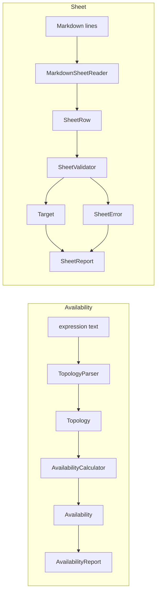

# Architecture

## The three packages

| Package | What it owns |
|---|---|
| `availability` | The `Availability` value type, `Component`, the sealed `Topology`, `TopologyParser`, `AvailabilityCalculator`, `Downtime`, `AvailabilityReport` and the `AvailabilityCli` entry point. |
| `sheet` | `MarkdownSheetReader`, `SheetRow`, `SheetValidator`, the records `Target`, `TargetScope`, `TargetMeasure` and `TargetOwnership`, the error types, `SheetReport` and the `SheetCli` entry point. |
| `labs` | `HoldPathLab` and `PaymentCapLab`: two worked examples that use the calculator. |

## The dependency rule

- `labs` depends on `availability`.
- `sheet` and `availability` do not depend on each other.
- Nothing depends on `labs`.
- The `*Cli` classes and the two lab classes are the only code that prints or exits. Everything else returns values.

The rule keeps each package small enough to read alone. It also means the sheet code can change its rules without touching the availability arithmetic.

## The two data flows

## One calculator run

Take `chain(gateway=99.9, seatwave=99.9, payments=99.9)`.

1. `AvailabilityCli` joins the arguments into one string and calls `TopologyParser.parse`.
2. The parser checks that the text is not blank and not longer than 2,000 characters.
3. It reads the word `chain`, sees the opening parenthesis, and reads each child. A child is a component (`name=percent`) or another group.
4. Each percent is checked against 0 to 100 before it is turned into an `Availability`. Success returns a `Topology.Chain` of three `Topology.Single` parts.
5. `AvailabilityReport.render` calls `AvailabilityCalculator.evaluate`. A chain multiplies the availability of its parts: 0.999 x 0.999 x 0.999 is 0.997002999.
6. `Downtime.allowedBy` turns the unavailable share into minutes of a 30-day month and a 365-day year.
7. The report names the weakest part and prints the text. `AvailabilityCli` writes it and exits with 0. A parse error is printed as one line and the exit status is 2.

## One validator run

Take `sheets/lab1-draft.md`.

1. `SheetCli` reads the file as UTF-8 lines and calls `MarkdownSheetReader.read`.
2. The reader keeps lines that start with `|`, drops the separator row, and turns each into a `SheetRow` with its line number and stripped cells. It checks the header against the eight column names.
3. `SheetValidator.validate` builds a target from each row. For each row it collects every problem, not only the first: missing fields, values that are not allowed, a threshold with no number, a wrong cell count.
4. A row with no problems becomes a `Target`. A row with problems becomes a `RowRejection`. A duplicate measure is then checked against the first line that set it.
5. If any row was rejected, the result is `SheetError.RowsRejected` with the count of good rows and every rejection. Otherwise it is the list of targets.
6. `SheetReport.rejected` prints one line per bad row. `SheetCli` writes it and exits with 1.

## Decisions and trade-offs

**An `Availability` value type.** A bare `double` can be 1.2 or NaN. The record rejects both in its constructor, so no number outside 0 to 1 exists anywhere in the program. The cost is one small wrapper around every number. The gain is that the calculator never has to check.

**A sealed `Topology` with an exhaustive switch.** There are three shapes: a single part, a chain and a parallel group. Every switch over them has no default branch. The trade-off is that a new shape forces a change in every switch. That is the point.

**Expected failures are `Result` values.** Bad user text, an incomplete row and a wrong header are normal events, so they come back as result4j `Result` values with sealed error types. Exceptions are for programmer errors, such as a null argument or an empty chain built in code. The trade-off is that callers must handle both branches. The compiler checks that they do.

**Records that validate themselves.** `TargetMeasure` and `TargetOwnership` check their fields in the compact constructor. Each has a static `problemsIn` method that the constructor and the validator both call. Each rule therefore exists once, and the validator can report every problem of a row instead of stopping at the first. The trade-off is that the validator still builds the record only after `problemsIn` returned nothing, so the check runs twice per good row. That cost is trivial here.

**Duplicates are rejected.** Two thresholds for one measure cannot both be the target. Rejecting the later row forces someone to choose. The alternative, keeping the last one, would hide a disagreement.

**Doubles for availability.** Money would need `BigDecimal`. Availability does not: inputs have at most six significant digits, and results are shown to six decimals of a percent. Rounding error in a product of a few dozen doubles is far below that. The percent text is converted with `BigDecimal`, so 99.9 becomes exactly 0.999 before it is a double.

## The two invariants and where each is enforced

1. **Every availability is between 0 and 1.** Enforced in the compact constructor of `Availability`. Every other class builds its values through that type. The parser checks the percent range first, so bad text becomes an error value and not an exception.
2. **No incomplete target exists.** Enforced in the compact constructors of `TargetScope`, `TargetMeasure` and `TargetOwnership`, and therefore in `Target`. The validator reports the same problems before it builds a record, using the shared `problemsIn` methods.

Tests attack both. They try values below 0, above 1, NaN and both infinities, and they try each missing field of a measure and of an ownership.

## Limits of the teaching build

- The parser accepts at most 2,000 characters and 16 levels of nesting. These are constants, not configuration.
- Independence of failures is assumed, not checked.
- The sheet reader knows only Markdown tables and expects the sheet to hold one table.
- The downtime figures use a month of 30 days and a year of 365 days.
- The command-line classes and the labs are not covered by the unit tests, because they call `System.exit`.

## How to extend it

To add a fourth topology shape, add a record to the sealed `Topology` interface. The build then fails in `AvailabilityCalculator.evaluate`, `AvailabilityReport.describe` and anywhere else that switches over it, until each one handles the new case. Nothing can forget it silently.

To add a column to the sheet, add a value to `SheetColumn`, a rule to the matching `problemsIn`, and update the header check, which reads the column list. To add a source format, write a second reader that returns the same `SheetRow` values. The validator does not change.
